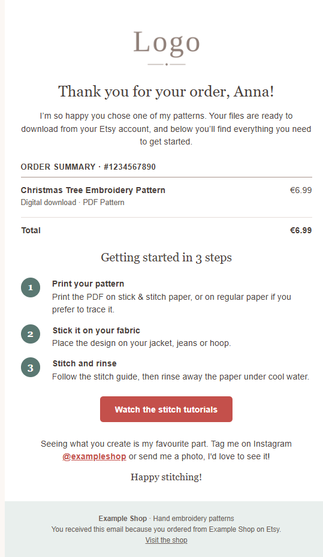
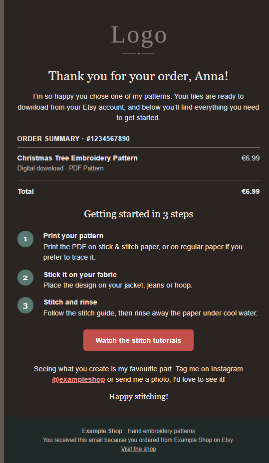
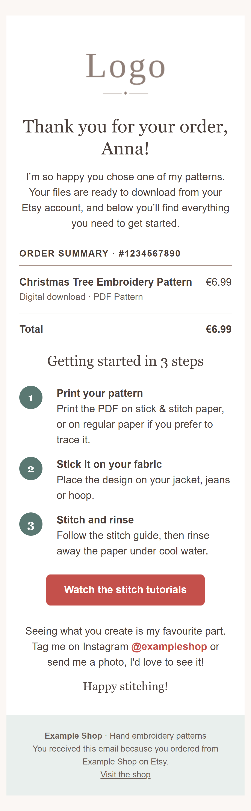
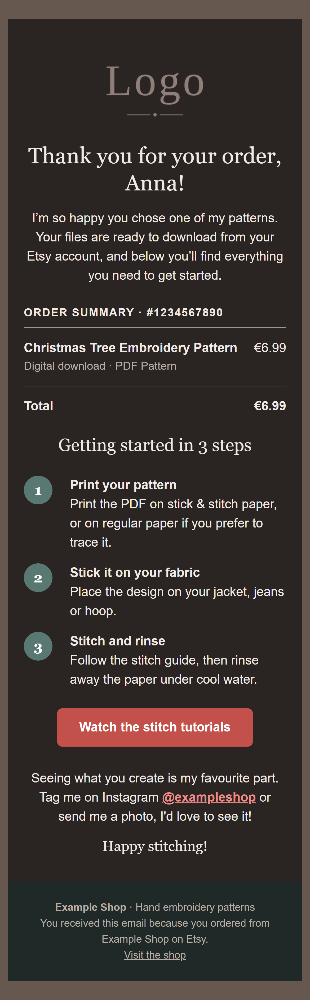

# Order confirmation email template

A responsive, dark-mode-ready HTML order confirmation email for a small embroidery shop that sells digital products, with a Node.js preview generator and a test sender.

> Portfolio project with sample data. It is not used to send real customer emails.

| Desktop Light mode | Desktop Dark mode | Mobile Light mode | Mobile Dark Mode |
| :---: | :---: | :---: | :---: |
|  |  |  |  |

## Features

- Table-based, 600px layout with inline CSS for broad email client support
- Responsive: shrinks to full width on small screens (`@media`, 20px side padding)
- Dark mode through `prefers-color-scheme`, with its own color palette
- Outlook-friendly button: VML for classic Outlook, a standard button everywhere else
- Accessibility basics: `role="presentation"` on layout tables, `lang` attribute, alt text, text contrast designed for WCAG AA (4.5:1)
- Shop-agnostic template: every shop-specific detail (name, links, logo) is a `{{placeholder}}`
- Small Node.js script that fills the placeholders, with HTML escaping
- Preview generator with three test customers (short name, long name, special characters)
- Script that sends the rendered email to a real inbox over SMTP
- `colors.js` helper that lists every color used in the template, to plan the dark mode palette

## Project structure

```
.
├── assets/
│   └── logo-placeholder.png   # placeholder logo, transparent PNG
├── docs/                      # screenshots used in this README
├── colors.js                  # lists every color used in the template
├── render.js                  # fills placeholders and writes previews/
├── send.js                    # sends the rendered email over SMTP
├── thank-you-email.html       # the email template
├── .env.example               # settings needed by send.js
└── package.json
```

`previews/` is generated by `render.js` and is not committed.

## Getting started

Requires Node.js 20.6 or newer.

```
npm install
npm run preview
```

This writes one HTML file per test customer to `previews/`. Open them in a browser, for example with the VS Code Live Server extension.

To check the responsive and dark mode behavior, use the browser DevTools: device mode for narrow screens, and the Rendering panel's `prefers-color-scheme: dark` emulation for dark mode.

To list every color used in the template:

```
node colors.js
```

## How placeholders work

The template contains `{{placeholders}}` in Handlebars style. In a real system, a backend or an email service fills them in before sending. `render.js` does the same thing locally.

| Placeholder | Meaning |
| --- | --- |
| `{{logo_url}}` | Logo image URL |
| `{{logo_alt}}` | Alt text of the logo |
| `{{shop_name}}` | Shop name (footer) |
| `{{shop_tagline}}` | Short shop description (footer) |
| `{{shop_url}}` | Link to the shop |
| `{{instagram_url}}` | Link to the Instagram profile |
| `{{instagram_handle}}` | Instagram handle shown in the text |
| `{{tutorials_url}}` | Target of the call-to-action button |
| `{{customer_name}}` | Customer's name |
| `{{order_number}}` | Order number |
| `{{pattern_name}}` | Product name |
| `{{price}}` | Order total |

In `render.js`, the values that are the same in every email live in `commonData`, and the values that change per customer live in the `testCases` list.

Details:

- Values are HTML-escaped (`&`, `<`, `>`, `"`), so a name like `<b>Anna</b>` is shown as text and cannot break the layout.
- Unknown placeholders are left untouched, and `render.js` prints a warning if any placeholder is left unreplaced, which makes typos easy to spot.
- The logo is a placeholder too, because a relative path works in a local preview but never in a real inbox.

## Sending a test email

1. Copy `.env.example` to `.env` and fill it in:

```
SMTP_HOST=smtp.gmail.com
SMTP_PORT=465
SMTP_USER=you@gmail.com
SMTP_PASS=your-app-password
MAIL_TO=you@gmail.com
```

2. Gmail needs an **app password** (2-Step Verification must be on), not your normal password.
3. Run:

```
npm run send
```

`.env` is listed in `.gitignore` and must never be committed.

`send.js` uses the sample data from the script and loads the logo from a public URL, because images in a real email must have an absolute URL.

## Design decisions

- **Tables and inline CSS.** Classic Outlook for Windows renders email with the Word engine, which does not reliably support flexbox, grid or many modern CSS properties. Tables with inline styles work everywhere.
- **Responsive without relying on `max-width: 100%`.** A percentage `max-width` on a table did not shrink it on mobile. The fix is a `container` class and an `@media` rule with `!important`, because inline styles would otherwise win. A separate `content-cell` class reduces the side padding on small screens.
- **Dark mode by role, not by element.** Colors are grouped into roles (page, card, text, muted text, divider, link, footer), and each role has one class. Every layer with its own background (body, outer table, card) needs its own class, otherwise the lighter layer hides the dark one. All overrides use `!important` to beat the inline styles.
- **Contrast over brand color.** A light brand coral is too weak for text with white lettering, so the button uses a darker coral. On dark backgrounds, links use a lighter coral to keep the contrast above 4.5:1.
- **One button per client.** MSO conditional comments serve a VML button to classic Outlook and hide it from every other client, so no client shows two buttons.
- **No shop-specific content in the template.** Everything that belongs to a particular shop (name, links, handle, logo) is a placeholder, so the template can be reused for any shop and the real values only live in the data.

## Testing

| Environment | Result |
| --- | --- |
| Browser device mode (about 390px wide) | No horizontal scrolling, text and button fit |
| Browser `prefers-color-scheme: dark` emulation | Custom dark palette applies |
| Gmail (web) | Renders as designed |
| Gmail (iOS app) | Renders well; in dark mode Gmail applies its own color inversion |
| Outlook.com (web) | Renders well; in dark mode Outlook applies its own color inversion |

Gmail and Outlook ignore the `prefers-color-scheme` rules and recolor the email themselves. The email stays readable because of the transparent logo and the contrast choices above.

Not tested yet: classic Outlook for Windows (Word rendering engine), Apple Mail, and services such as Litmus.

## Known limitations and next steps

- Classic Outlook for Windows is untested. Its rendering engine does not support rounded corners, so the numbered circles are expected to show as squares there.
- The logo is loaded from a public repository URL for testing. A production setup should host images on a CDN or with the email service.
- The custom dark palette applies in clients that follow `prefers-color-scheme`, such as Apple Mail (not tested yet).
- Planned: a preheader (the inbox preview text).
- Planned: a second template with a two-column layout that stacks on mobile.
- Planned: automated checks for the rendered output, for example that no `{{placeholder}}` remains.